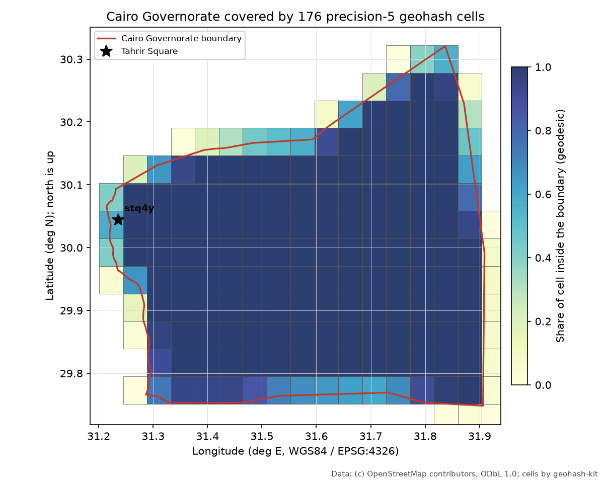

# geohash-kit

Encode and decode geohashes, find a cell's neighbours, and cover a polygon with
geohashes at a chosen precision. Small, with two dependencies: `pyproj`
(WGS84 ellipsoid areas) and `shapely` (geometry validity and intersection).

Geohashes turn a lon/lat location into a short string whose prefix identifies
a larger area, which makes them handy for bucketing, joining and indexing
spatial data. `geohash-kit` gives a CLI and a Python API for the common tasks.

- [Open in Colab](https://colab.research.google.com/github/AmmarYasser455/geohash-kit/blob/main/examples/demo.ipynb): [](https://colab.research.google.com/github/AmmarYasser455/geohash-kit/blob/main/examples/demo.ipynb)
- [Demo map](https://ammaryasser455.github.io/geohash-kit/): Central Park covered with precision-6 cells.

## Showcase

Cairo Governorate (OpenStreetMap boundary) covered by precision-5 geohash cells:



See [showcase/](showcase/README.md) for the report, the [web map](showcase/index.html),
the [notebook](showcase/showcase.ipynb) and [map.geojson](showcase/map.geojson).

## Install

```
pip install git+https://github.com/AmmarYasser455/geohash-kit
```

## CLI

Points are `lat lon` (degrees, WGS84). GeoJSON input is lon/lat (x, y) as per RFC 7946.

```
$ geohash-kit encode 57.64911 10.40744 -p 11
u4pruydqqvj

$ geohash-kit decode ezs42
lat=42.60498046875 lon=-5.60302734375
bbox(min_lon,min_lat,max_lon,max_lat)=-5.625,42.5830078125,-5.5810546875,42.626953125

$ geohash-kit neighbours ezs42
n: ezs48
ne: ezs49
e: ezs43
se: ezs41
s: ezs40
sw: ezefp
w: ezefr
nw: ezefx

$ geohash-kit cover examples/central_park.geojson -p 5
dr5ru
dr72h
dr72j
```

`decode` prints coordinates in full (shortest exact float form), so even
precision-12 cells keep distinct bounds. `cover` takes `--mode within` (only cells fully inside) and `--geojson` (cell
polygons with `geohash` and ellipsoidal `area_km2` properties). The input may be
a FeatureCollection, a Feature or a bare Polygon/MultiPolygon/GeometryCollection;
null and empty geometries are skipped, and malformed or invalid input exits with
status 1 and an `error:` message instead of being repaired. Raw coordinates are
checked before shapely sees them: every ring needs at least four `[lon, lat]`
(or `[lon, lat, z]`) positions of finite JSON numbers and must be explicitly
closed, so open rings, numeric strings and booleans are rejected.

## Python

```python
import geohash_kit as gk
from shapely.geometry import box

gk.encode(57.64911, 10.40744, 11)      # 'u4pruydqqvj'
gk.decode("ezs42")                     # (42.60498..., -5.60302...)  (lat, lon)
gk.decode_bbox("ezs42")                # (min_lon, min_lat, max_lon, max_lat)
gk.neighbours("ezs42")["n"]            # 'ezs48'
gk.cover(box(10.0, 50.0, 10.5, 50.3), 4)   # sorted list of geohashes
gk.cell_area_km2("dr5rus")             # 0.5658797...
gk.read_geometry("examples/central_park.geojson")  # validated shapely Polygon
```

Bad input (NaN, out-of-range or non-numeric coordinates, non-string geohashes,
wrong precision, non-polygonal or invalid geometries) raises `ValueError`.

See [examples/demo.ipynb](examples/demo.ipynb) and [examples/README.md](examples/README.md)
for the sample data (a simplified Central Park outline).

## Limitations

- WGS84 lon/lat only; inputs in another CRS must be reprojected first (e.g. with pyproj). A legacy GeoJSON `crs` member on any object must name OGC:CRS84 or EPSG:4326 (read as lon/lat); any other, malformed or null declaration is rejected. Files without a `crs` member are assumed to be RFC 7946 WGS84 lon/lat, so projected coordinates without a declaration cannot be detected if they fall inside the lon/lat limits.
- Geometries crossing the antimeridian are rejected (checked on each input polygon before parts are merged); split them first. Neighbour lookup does wrap across it.
- Cells are lon/lat boxes, so covers follow the geohash grid, not equal-area cells; cell area shrinks with latitude.
- `cell_area_km2` is the WGS84 ellipsoidal area of the lon/lat rectangle, computed with `pyproj.Geod`. Cells taller than 0.01 degrees (precision 1..5) use the geodesic polygon area after densifying the constant-latitude edges every 0.05 degrees of longitude; the residual error is below 0.01 % (the 32 precision-1 cells sum to the ellipsoid surface area within that tolerance). Smaller cells (precision 6..12) use the `Geod` width along the middle parallel times the `Geod` meridian height, which avoids the rounding loss of a polygon area for tiny polar cells; this approximation's relative error is below 1e-8. GeoJSON output keeps 9 significant digits.
- Polygon cover tests cells with planar intersection in degrees (cell edges are straight lon/lat lines), not geodesic edges.
- Invalid polygons raise an error rather than being repaired; only (Multi)Polygon is covered.
- Precision is limited to 1..12 and a cover is limited to 200,000 candidate cells.
- At the poles, neighbours that would leave the globe are omitted.
- The example outline is an approximation of Central Park, not an official boundary.

## Development

```
pip install -e . pytest
pytest
```

MIT licensed, see `LICENSE`.
