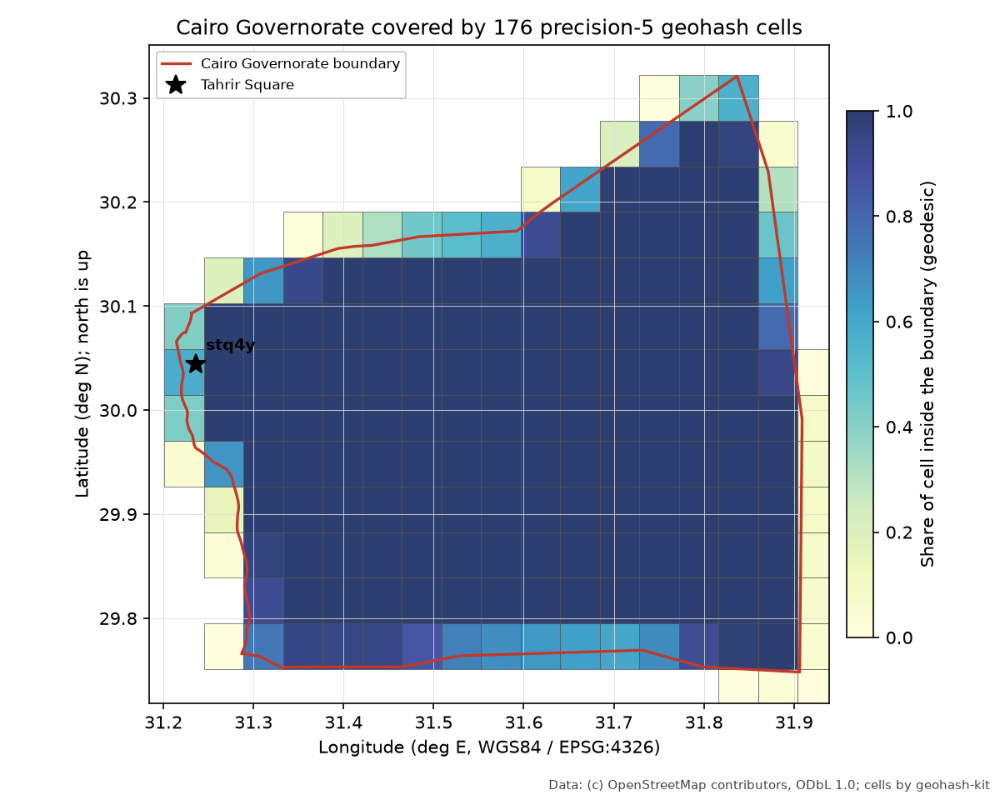

# Cairo Governorate as precision-5 geohash cells

## Question

How many precision-5 geohash cells (about 5 km wide) are needed to cover Cairo Governorate, Egypt, and how much of each border cell actually lies inside it?

## Data

- `data/cairo_governorate.geojson`: boundary of Cairo Governorate (OpenStreetMap relation 4103336), 3 KB.
- Source: OpenStreetMap via the Overpass API, `https://overpass-api.de/api/interpreter` with query `rel(4103336);out geom;` (see `fetch_data.py`, which assembles the outer ways into a polygon).
- License: ODbL 1.0, (c) OpenStreetMap contributors, <https://www.openstreetmap.org/copyright>.
- Date fetched: 2026-11-19 (OSM database timestamp 2026-11-19T22:35:28Z).

## Method

- `geohash_kit.read_geometry` loads the boundary (WGS84 lon/lat, x = lon, y = lat).
- `geohash_kit.cover(boundary, 5)` lists every cell touching the boundary; `cover(boundary, 5, "within")` lists cells fully inside it.
- `geohash_kit.cell_area_km2` gives each cell's WGS84 ellipsoidal area. For edge cells the part inside the boundary is the cell/boundary intersection, measured with `pyproj.Geod` (geodesic area, km²); the intersection itself is planar in degrees, as the cover is.
- `geohash_kit.encode` / `neighbours` locate Tahrir Square (30.0444 N, 31.2357 E) and its 8 neighbours.
- CRS: EPSG:4326 throughout (`map.geojson` is RFC 7946 lon/lat). Areas are in km², never computed from degrees.

## Results

- The boundary has a geodesic area of 3,007 km².
- 176 cells touch it: 117 lie fully inside (2,417 km²) and 59 are edge cells.
- The 176 cells total 3,636 km², 20.9 % more than the boundary, because edge cells extend outside it.
- Edge cells vary from almost empty (stq9h has 0.2 % inside) to mostly inside; the share is stored per cell as `share_inside`.
- Tahrir Square falls in cell `stq4y`, an edge cell on the western boundary along the Nile.



- Web map: [index.html](index.html) (Leaflet; needs OpenStreetMap tiles online, and must be served over http, e.g. `python -m http.server` in this folder, so it can fetch the GeoJSON)
- Notebook: [showcase.ipynb](showcase.ipynb) (outputs saved)
- Result layer: [map.geojson](map.geojson)

## Limitations

The OSM boundary is a simplified outline; the cover tests planar cell/polygon intersection in degrees, so edge shares are approximate.

## Rebuild

```
python showcase/make_showcase.py
```

It runs offline from `data/`. The notebook can be re-executed from this folder with `python -m jupyter nbconvert --to notebook --execute --inplace showcase.ipynb`. `fetch_data.py` is only needed to refresh the data.
